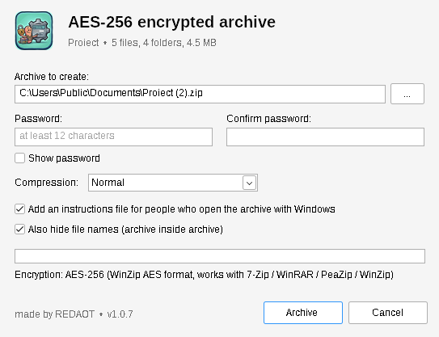
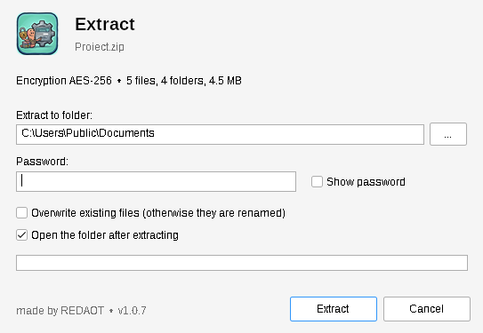
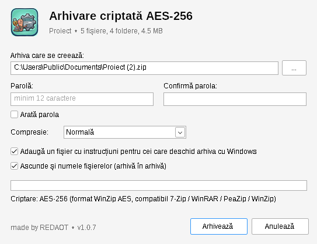

  

<h1 align="center">RedaotZip</h1>

  <b>AES-256 encrypted ZIP archiver for Windows, right in the right-click menu.</b> 
  made by REDAOT · English / Română

  <a href="https://github.com/redaot/RedaotZip/releases/latest"><b>⬇ Download the latest version</b></a> ·
  <a href="docs/MANUAL.en.md">Manual (EN)</a> ·
  <a href="docs/MANUAL.ro.md">Manual (RO)</a> ·
  <a href="#română">Română</a>

---

RedaotZip creates and extracts **password-protected ZIP archives encrypted with AES-256**. On Windows 11 its options appear **directly** in the right-click menu, without "Show more options".

Archives use the standard **WinZip AES** format, so they also open in **7-Zip, PeaZip, WinRAR and WinZip**. RedaotZip never creates archives with the old, easily broken ZipCrypto encryption.

  
  

## Features

- **AES-256** encryption (WinZip AE-2) with an HMAC authenticity check: tampering is detected
- **Hide file names**: files go into an encrypted inner archive, so nobody sees what is inside without the password (on by default)
- **Right-click menu** on Windows 11 (top level) and Windows 10: *Archive with REDAOT* on any file or folder, *Extract with REDAOT* on .zip files
- **Instructions file** added to each archive for recipients who try the built-in Windows ZIP tool (which cannot open AES archives)
- **ZIP64**: files over 4 GB and more than 65,535 files
- Unicode file names, long paths, protection against malicious paths (zip-slip)
- Password strength meter, progress bar, cancel at any time without leaving a half-written archive
- Opens regular ZIP, AES ZIP from other programs and old ZipCrypto archives
- Single native executable (C++ / Win32, Windows CNG cryptography), no runtime to install
- Interface in **English** and **Romanian**

## Installation

1. Download **`RedaotZip-x.y.z-Setup.exe`** from [Releases](https://github.com/redaot/RedaotZip/releases/latest).
2. Run it. If "Windows protected your PC" appears, click **More info → Run anyway** (the program is not signed by a paid certificate authority).
3. Choose the language and click **Install**. Explorer restarts at the end and the menu is ready.

Requires Windows 10 version 2004 or newer, or Windows 11, 64-bit.

Uninstall from **Settings → Apps → Installed apps → RedaotZip**.

> **Why does Setup add a certificate?** Windows 11 only shows signed packages in the top-level right-click menu. Setup adds the REDAOT certificate to *Trusted People* so the two small RedaotZip menu packages can be registered. It is removed when you uninstall.

## Opening the archives elsewhere

The ZIP tool built into Windows **cannot** open AES-256 archives: it shows error 0x80004005 and never asks for the password. Recipients need RedaotZip, [7-Zip](https://www.7-zip.org), [PeaZip](https://peazip.github.io), [WinRAR](https://www.win-rar.com) or [WinZip](https://www.winzip.com).

## Security notes

- An archive is only as safe as its password. Use at least 12 characters; there is no way to recover a forgotten password.
- The WinZip AES format fixes key derivation at PBKDF2-HMAC-SHA1 with 1,000 iterations for compatibility, so long passwords matter.
- Without "hide file names", the names and sizes of the files are visible without the password (a limitation of the ZIP format).

## Building from source

See [BUILDING.md](BUILDING.md). The project cross-compiles on Linux with MinGW-w64 and NSIS.

## License

[MIT](LICENSE) © REDAOT. Uses [zlib](https://zlib.net) (zlib license); the installer is built with [NSIS](https://nsis.sourceforge.io).

---

## Română

**RedaotZip** este un arhivator ZIP pentru Windows cu **criptare AES-256**, direct în meniul de click dreapta (pe Windows 11 fără „Show more options”). Arhivele se deschid și cu 7-Zip, PeaZip, WinRAR și WinZip.

- **Descarcă:** `RedaotZip-x.y.z-Setup.exe` din [Releases](https://github.com/redaot/RedaotZip/releases/latest), rulează-l, alege limba și apasă **Instalează**.
- **Folosire:** click dreapta pe fișiere → *Arhivează cu REDAOT (AES-256)*; click dreapta pe o arhivă .zip → *Dezarhivează cu REDAOT*.
- **Important:** utilitarul ZIP din Windows nu poate deschide arhive AES-256. Destinatarul are nevoie de RedaotZip, 7-Zip, PeaZip, WinRAR sau WinZip; în fiecare arhivă se pune un fișier cu aceste instrucțiuni.
- **Manual complet:** [docs/MANUAL.ro.md](docs/MANUAL.ro.md)

